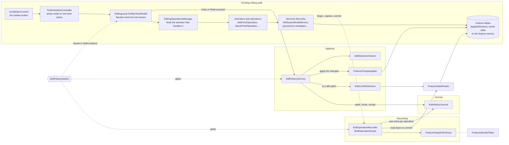
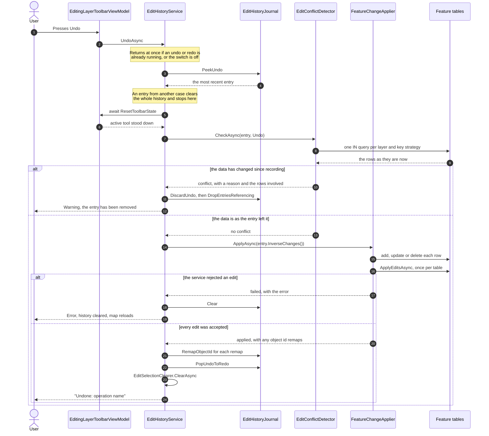
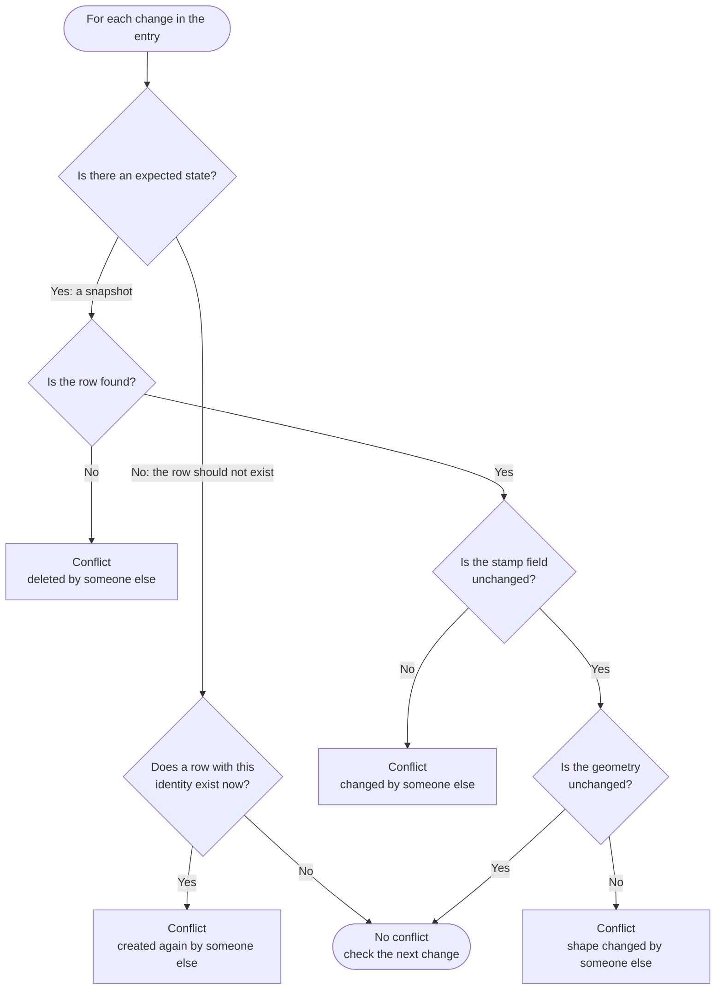
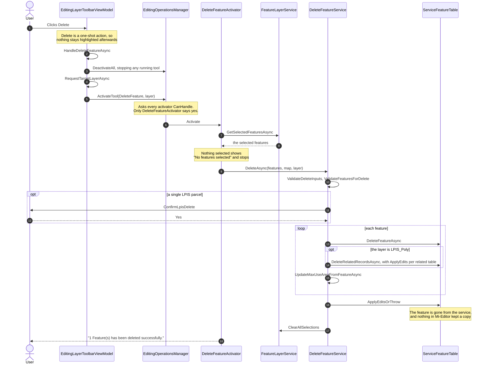
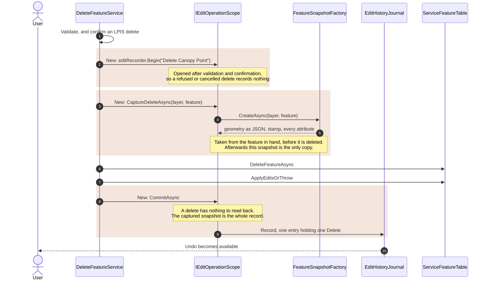
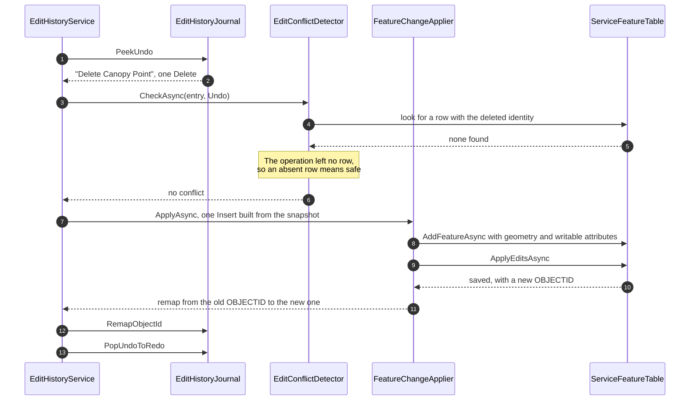

# Edit history: the undo and redo framework

This document is for engineers working on Mi-Editor's editing tools. It explains how the edit
history records an operation, how undo and redo reverse it, and what a new editing feature has to do
to take part. Feature specific detail lives in [features/](#feature-documents).

All code lives in `Src/MiEditor.Core/Services/Drawing/Editing/History/`, unless stated otherwise.

## Contents

1. [Status](#status)
2. [The model in one page](#the-model-in-one-page)
3. [Where the code is](#where-the-code-is)
4. [Recording an operation](#recording-an-operation)
5. [Undo and redo](#undo-and-redo)
6. [Conflict detection](#conflict-detection)
7. [Applying changes and object id remapping](#applying-changes-and-object-id-remapping)
8. [The journal](#the-journal)
9. [Row identity](#row-identity)
10. [Switching the feature on and off](#switching-the-feature-on-and-off)
11. [When history is cleared](#when-history-is-cleared)
12. [UI integration](#ui-integration)
13. [Adding undo to an editing feature](#adding-undo-to-an-editing-feature)
14. [Testing](#testing)
15. [Known limitations](#known-limitations)
16. [Feature documents](#feature-documents)

## Status

| Feature | Recorded | Document |
| --- | --- | --- |
| Create Point (and other inserts through the attribute form) | Yes | [features/create-point.md](features/create-point.md) |
| Move Point | Yes | [features/move-point.md](features/move-point.md) |
| Delete, vertex add, move and delete, buffer, merge, split | No | |
| Attribute modify | No | |
| Any LPIS parcel save (`LpisAttributionModelService`) | No | |

A feature that does not record is unaffected by the history. Its edits are not undoable, and they do
not interfere with entries that other features have recorded, except through the conflict check
described below.

## The model in one page

The framework never stores "how to undo a move" or "how to undo a split". It stores **what changed
in each row**, and it derives the reverse mechanically.

| Type | Folder | What it is |
| --- | --- | --- |
| `FeatureIdentity` | `Model` | Names one row: layer name, `OBJECTID`, and optionally a unique identifier field and value. |
| `FeatureSnapshot` | `Model` | One row at one moment: identity, geometry as Esri JSON, the last modified stamp, and every attribute. Immutable once taken. |
| `FeatureChange` | `Model` | One primitive row change: `Insert` (after only), `Update` (before and after), or `Delete` (before only). Validated on construction. |
| `EditOperationEntry` | `Model` | One user operation, however many rows or tables it touched. One entry is one press of Undo. Carries the operation name shown to the user and the case number it was recorded against. |

Each change has an inverse:

| Change | Inverse |
| --- | --- |
| `Insert(after)` | `Delete(after)` |
| `Delete(before)` | `Insert(before)` |
| `Update(before, after)` | `Update(after, before)` |

Undo applies `entry.InverseChanges()`, which is the change list **reversed** and each change
inverted, so child rows are handled before the parents they reference. Redo applies `entry.Changes`
as recorded. One applier serves both directions.

```csharp
public IReadOnlyList<FeatureChange> InverseChanges() =>
    [.. Changes.Reverse().Select(change => change.Inverse())];
```

## Where the code is

### Architecture

The history sits beside the existing editing path, not inside it. The left column is the path every
editing tool already takes, from the toolbar button down to the feature table. The framework joins it
at one point only: the service that writes the edit opens a scope, captures what it is about to
change, and commits once the write has succeeded. Everything to the right is new.



Reading the diagram:

- **Recording** is reached only through the dotted edge from the writing service. An editing
  feature that does not call the recorder is invisible to the history.
- **The journal** is the only state. It holds entries; it never touches a table.
- **Applying** is driven from the toolbar, not from the editing path. Undo does not rewind
  anything: it is a new edit, written through the same feature tables as any other.
- **`FeatureStateReader`** is shared by recording and conflict detection, so the state recorded and
  the state later compared against it are read the same way.
- **`IEditHistorySwitch`** gates all three consumers. When it is off, nothing is recorded, nothing
  is applied, and the buttons are hidden.

Two links are not drawn, to keep the diagram readable. `EditHistoryService` sends
`ResetToolbarState` to the toolbar before applying anything, and it republishes the journal's
`Changed` event as `EditHistoryChangedMessage`, which enables and disables the buttons. Both are
described in [UI integration](#ui-integration).

### Folders and types

The `History` folder has five subfolders, one per phase, plus the switch at the root because it
governs all of them. Interfaces live in the same file as their implementation.

| Folder | Type | Lifetime | Responsibility |
| --- | --- | --- | --- |
| root | `EditHistorySwitch` | Singleton | Whether history is in use: deployment availability and user preference combined. |
| `Model` | `FeatureIdentity`, `FeatureSnapshot`, `FeatureChange`, `FeatureChangeKind`, `EditOperationEntry`, `AppliedEdit` | n/a | Pure records. No I/O. |
| `Model` | `FeatureIdentityPolicy` | Singleton | Which field identifies a row and which field stamps its last change, per layer. |
| `Journal` | `EditHistoryJournal` | Singleton | The bounded undo and redo stacks. No Esri types, no I/O, thread safe. |
| `Recording` | `EditOperationRecorder`, `IEditOperationScope` | Scoped | The API editing features call to record an operation. |
| `Applying` | `EditHistoryService` | Scoped | The entry point for Undo and Redo. Orchestrates the steps below. |
| `Applying` | `EditConflictDetector` | Scoped | Refuses an undo or redo that would overwrite someone else's change. |
| `Applying` | `EditSelectionClearer` | Scoped | Clears map selection after a change. A one method seam over `IFeatureLayerService`. |
| `FeatureTables` | `FeatureSnapshotFactory` | Scoped | Converts between ArcGIS features and snapshots. |
| `FeatureTables` | `FeatureStateReader` | Scoped | Reads a row's current state from its table. |
| `FeatureTables` | `FeatureChangeApplier` | Scoped | Writes changes to the tables and reports object ids the service replaced. |

Only the `FeatureTables` types touch ArcGIS objects (plus `GeometryEngine` in the conflict
detector). Everything else can be unit tested without the Esri runtime.

The scoped services behave as singletons in practice, because the application creates one scope.
`EditHistoryService` relies on that: it subscribes to the journal and to messenger events in its
constructor.

Supporting types outside the folder:

| Type | Location |
| --- | --- |
| `EditHistoryInfo` (limits and availability) | `Src/MiEditor.Shared/Configuration/AppSettings/EditHistoryInfo.cs` |
| `EditHistoryChangedMessage` | `Src/MiEditor.Shared/Messages/Toolbar/EditHistoryChangedMessage.cs` |
| `ResetToolbarState` | `Src/MiEditor.Shared/Messages/Editing/ClearEditingGraphicMessage.cs` |
| `IUserPreferenceService.HistoryEnabled` | `Src/MiEditor.Core/Services/UserPreferences/` |
| `UndoToolDescriptor`, `RedoToolDescriptor` | `Src/MiEditor.MainApp/ViewModels/Toolbar/Descriptors/EditingTools/` |
| Toolbar wiring | `Src/MiEditor.MainApp/ViewModels/Toolbar/EditingLayerToolbarViewModel.cs` |
| Settings card | `Src/MiEditor.MainApp/ViewModels/Settings/SettingsSidebarControlViewModel.cs` and `Controls/Settings/SettingsSidebarControl.xaml` |

## Recording an operation

Editing features depend on `IEditOperationRecorder` only. They never touch the journal directly.

### The scope

`IEditOperationRecorder.Begin(operationName)` returns an `IEditOperationScope`. The name is what the
user sees after an undo, so write it as the action taken: `Add Canopy Point`, `Move Canopy Point`.

| Method | Call it | What it does |
| --- | --- | --- |
| `MarkInsert(layer, feature)` | Before or after `AddFeatureAsync` | Notes the feature. Nothing is read yet, because the row has no final object id. |
| `CaptureUpdateBeforeAsync(layer, feature)` | **Before** the feature is mutated | Snapshots the current state. This is the before state undo restores. |
| `CaptureDeleteAsync(layer, feature)` | **Before** `DeleteFeatureAsync` | Snapshots the row. After the delete this is the only copy of it. |
| `ResolveInsertedObjectIds(layer, applied)` | After `ApplyEditsAsync`, before `CommitAsync` | Pairs marked inserts with the object ids the service assigned. Required for service tables. |
| `CommitAsync()` | After the edit has been saved | Reads each touched row back from its table and records one entry. |
| `Dispose()` | Always, via `using` or `finally` | Discards everything not committed. |

### The rules the scope enforces

- **Nothing is recorded unless `CommitAsync` runs.** A failed, cancelled or abandoned operation
  disposes the scope and leaves no trace.
- **One scope is one entry.** `Begin` holds no ambient state. If an operation spans several
  services and must undo as one step, pass the scope down the call chain.
- **Commit is single use.** A second `CommitAsync` logs a warning and records nothing.
  `ResolveInsertedObjectIds` after commit also logs and is ignored.
- **The after state is read from the table, not from the in-memory feature.** `CommitAsync` reads
  each inserted and updated row back through `IFeatureStateReader`. `ApplyEditsAsync` does not
  write service-generated values (object id, tracking fields) back onto the local feature, so the
  feature is not a reliable after state.
- **An entry with no changes is not recorded.** If every pending row is skipped (see below) or
  nothing was captured, the journal is untouched.

### When a row is skipped

`CommitAsync` drops an individual change, logs a warning prefixed `Edit history:`, and records the
rest when:

- an inserted row's object id is zero or negative. A negative id is the local cache placeholder and
  means `ResolveInsertedObjectIds` was not called for a service table;
- the number of successful inserts in the `ApplyEdits` result does not match the number of marked
  inserts on that layer, so they cannot be paired safely;
- an inserted or updated row cannot be read back.

### Oversized operations

If a single entry is larger than `EditHistoryInfo.MaxTotalBytes`, the journal refuses it and
leaves existing history alone. The recorder tells the user directly with a warning,
"*operation* was saved, but it is too large to be undone." Callers do not need to relay anything.

### When history is off

`Begin` returns a stateless `DiscardingScope` whose methods do nothing. Call sites are unchanged
and pay nothing: no snapshots, no read-back queries, no memory held.

### Exceptions from `CommitAsync`

`CommitAsync` reads from the feature service, so it can throw (for example, on a dropped
connection). It does not catch. By the time it runs, the edit has already been saved, so the caller
must not let that exception report the edit itself as failed. See Move Point for the pattern:
commit last, in its own `try`, and on failure warn that the change cannot be undone.

## Undo and redo

`IEditHistoryService` is the only thing the UI calls. `UndoAsync` and `RedoAsync` share one
pipeline in `EditHistoryService.ApplyAsync`. The diagram shows an undo; a redo differs only in the
stack it reads from, the changes it applies, and where the entry moves, as listed after it.



| | Undo | Redo |
| --- | --- | --- |
| Reads | `PeekUndo` | `PeekRedo` |
| Conflict check expects | each change's `After` | each change's `Before` |
| Applies | `entry.InverseChanges()` | `entry.Changes` |
| On conflict | `DiscardUndo` | `ClearRedo` |
| On success | `PopUndoToRedo` | `PopRedoToUndo` |

The same steps, in order:

1. **Reentrancy guard.** If an undo or redo is already running, return. The toolbar does not await
   the click, so a double click would otherwise run two.
2. **Switch guard.** If `IEditHistorySwitch.IsEnabled` is false, return. Refused here as well as
   hidden in the UI, so a future keyboard shortcut cannot bypass it.
3. **Peek** the top entry of the relevant stack. Nothing there, nothing to do.
4. **Case guard.** If the entry's `CaseKey` is not the open case number, log a warning, clear the
   whole history and stop. Clearing on case change should already have happened; this catches a
   missed message.
5. **Stand the editing tools down.** `await messenger.Send<ResetToolbarState>()`. Tools may hold
   references to the features about to change. The send is awaited, so it needs a recipient that
   replies (see [UI integration](#ui-integration)).
6. **Conflict check.** If the live data no longer matches what the entry expects, refuse: undo
   discards that entry, redo clears the entire redo stack (later redos may depend on it), and any
   other entry referencing the conflicting rows is dropped. The user gets a warning naming the
   reason.
7. **Apply** the inverse changes for undo, or the recorded changes for redo.
8. **On apply failure,** show an error, **clear all history**, and send `RefreshMessage` to reload
   the map. The data no longer matches what was recorded, and a later press could make things worse.
9. **Remap object ids** reported by the applier across both stacks.
10. **Move the entry** to the other stack.
11. **Clear map selection**, since restored rows may have new object ids.
12. Show a success notification, "Undone: *name*" or "Redone: *name*".

Steps 3 to 12 run inside `IOperationFeedbackService.RunAsync`, which shows the spinner and turns an
unhandled exception into an error notification titled Undo or Redo.

## Conflict detection

`EditConflictDetector.CheckAsync(entry, direction)` makes sure an undo or redo never overwrites a
change made since the entry was recorded, by this user through an unrecorded tool or by someone else.

**What is compared.** For each change, the expected state is the state the history last left the
row in:

| Direction | Expected state |
| --- | --- |
| Undo | `change.After` (what the operation produced) |
| Redo | `change.Before` (what the undo restored) |

Each change is then checked against the live row:



- **No expected state** means the history last left the row deleted. That is the case when undoing
  a delete (the operation removed the row) and when redoing an insert (the undo removed it). The row
  must still be absent.
- **The stamp field** is `LATESTMOD` or `MODIFIEDDT`, depending on the layer (see
  [Row identity](#row-identity)). Every edit through the application updates it, so a changed stamp
  means another edit.
- **Geometry** is compared as text first. Only if the JSON differs are both geometries parsed and
  compared with `GeometryEngine.Equals`, to avoid false conflicts from equivalent serialisations.

The first conflict found wins, and the whole entry is refused. A partial undo is never attempted.

**How rows are read.** Live rows are read in batches, one `IN` query per layer and key strategy
(keyed rows and keyless rows need different `WHERE` clauses, and a keyed layer can contain both).
Identities are deduplicated with `SameRowAs`, not equality. `IFeatureStateReader.ReadManyAsync`
throws on a mixed batch rather than silently missing rows, and throws if the layer cannot be
resolved, so an unloaded layer is reported as an error and not as "deleted by someone else".

## Applying changes and object id remapping

`FeatureChangeApplier.ApplyAsync(changes)`:

1. Resolves each layer once and caches it.
2. Applies each change locally: `Insert` creates a feature from the snapshot's geometry and writable
   attributes; `Update` finds the row and overwrites geometry and writable attributes; `Delete`
   finds the row and deletes it. A delete whose row is already gone is logged and treated as done.
   An update whose row is gone throws.
3. Calls `ApplyEditsAsync` once per touched `ServiceFeatureTable` when online. Any result with
   errors fails the whole apply.
4. Returns `ObjectIdRemap` values for re-inserted rows.

"Writable attributes" are every snapshot attribute except `OBJECTID`, `GLOBALID`, `SHAPE` and any
`SHAPE_*` field, which the service owns. On insert, only attributes that exist on the table are set.
Rows are located by unique identifier where the identity has one, otherwise by `OBJECTID`.

**Why remapping exists.** Re-inserting a row (undo of a delete, redo of an insert) gives it a new
`OBJECTID`. Every entry in either stack that refers to the old id must be rewritten, or the next
undo would look for a row that no longer has that id. `EditHistoryService` passes each remap to
`IEditHistoryJournal.RemapObjectId`, which rewrites matching snapshots in both stacks.

How the new id is found:

| Table | Source of the new id |
| --- | --- |
| Not a service table, or offline | The feature's `OBJECTID` after `AddFeatureAsync`. |
| Service table, online | The `ApplyEdits` result, paired with the inserts **by order**. |

If the number of successful inserts in the result does not match the number re-inserted, no remap
is made and a warning is logged. The stale ids then fail the next conflict check, so the affected
entry is refused rather than aimed at the wrong row. Remaps to zero, a negative id or the same id
are discarded.

`AppliedEdit` is a testable projection of Esri's `EditResult`, which has no public constructor.
`AppliedEdit.From` is the only code that reads `EditResult`, and `AppliedEdit.MatchInsertedIds` is
the single pairing rule used by both the recorder and the applier.

## The journal

`EditHistoryJournal` holds two linked lists, undo and redo.

- **Recording clears redo**, always, even when the new entry is then rejected as oversized.
- **Depth limit:** `MaxUndoDepth` (default 10). The oldest undo entries are evicted first.
- **Size limit:** `MaxTotalBytes` (default 64 MiB) across both stacks. Oldest undo entries are
  evicted until the total fits. The new entry is always kept, because it has already been checked
  to fit on its own.
- Size is approximate: two bytes per character of geometry JSON, attribute names and string values,
  and eight bytes for any other value.
- **Thread safe.** Every member takes a lock. `Changed` is raised outside the lock, so a handler may
  call back into the journal.
- `DropEntriesReferencing(identities)` removes any entry in either stack that touches one of the
  rows, matched with `SameRowAs`.

## Row identity

`FeatureIdentity.SameRowAs` decides whether two identities name the same row: same layer (case
insensitive), then unique identifier if both have one, otherwise `OBJECTID`.

`FeatureIdentityPolicy` supplies the per-layer fields:

| Layer | Unique identifier field | Stamp field |
| --- | --- | --- |
| `Layers.LPIS_Poly` | `POLYGONID` | `LATESTMOD` |
| Every other layer | none | `MODIFIEDDT` |

A unique identifier survives delete and re-insert, so LPIS parcels never need remapping. Every other
layer is identified by `OBJECTID` alone and depends on remapping. `LPISPOLYID` on child layers is
not a unique identifier: it names the parent parcel and is shared by every child.

A snapshot taken from an LPIS parcel whose `POLYGONID` is null falls back to a keyless identity,
which is why the conflict detector groups by key strategy as well as by layer.

## Switching the feature on and off

`IEditHistorySwitch` combines two settings. Everything else consults the switch, never the two
settings directly.

```csharp
public bool IsEnabled => IsAvailable && preferences.HistoryEnabled;

public bool IsAvailable => settings.Available;
```

| Setting | Where | Default | Meaning |
| --- | --- | --- | --- |
| `EditHistory.Available` | `appsettings*.json`, bound to `EditHistoryInfo` | `true` | The deployment offers the feature. Set `false` to withdraw it estate wide without new binaries. Wins over the user. |
| `HistoryEnabled` | `IUserPreferenceService`, stored per user | `false` | The user has opted in. The feature ships dark. |

```json
"EditHistory": {
  "MaxUndoDepth": 10,
  "MaxTotalBytes": 67108864,
  "Available": true
}
```

Behaviour:

- **Off means off.** The recorder hands out discarding scopes, and `UndoAsync` and `RedoAsync`
  return without doing anything.
- **Switching off clears the history.** Keeping it would offer, on a later switch back on, undo of
  operations the user may have built on since.
- **Switching on starts recording.** Nothing is restored.
- The switch reads the user preference and never writes it, so withdrawing the feature does not
  erase the user's choice.
- `Changed` fires only when `IsEnabled` actually changes.
- With `Available` false, a line is logged at startup, the History card is not shown in settings,
  and the Undo and Redo buttons are hidden.

## When history is cleared

History is scoped to one case and one editing session. `EditHistoryService` clears it on:

- `SelectedCaseMessage`
- `SelectedCaseStartEditingMessage`
- `SelectedCaseStopEditingMessage`
- `ExitCaseMessage`
- the switch turning off
- a failed apply (step 8 above)
- an entry whose case key does not match the open case (step 4 above)

## UI integration

**Buttons.** Undo and Redo are `EditingTool` values on the **editing** toolbar, described by
`UndoToolDescriptor` and `RedoToolDescriptor` with `ToolActivation.Action`, so they fire once and
never stay active. `EditingLayerToolbarViewModel` dispatches them to `IEditHistoryService`.

**Enabled state.** The journal's `Changed` event is republished by `EditHistoryService` as
`EditHistoryChangedMessage(CanUndo, CanRedo)`, which the toolbar receives to enable or disable the
buttons.

**Visibility.** Hidden, not disabled, when the switch is off. `ApplyToolVisibility` is the single
place that decides button visibility: the tool must be in scope for the layer's geometry and on
offer. It reruns on layer render and on `IEditHistorySwitch.Changed`.

**Standing tools down.** `ResetToolbarState` is an `AsyncRequestMessage<bool>`. The toolbar replies
with a task that deactivates all editing operations and the active tool. `EditHistoryService` awaits
it, and the send throws if nothing replies. Any test that runs an undo or redo must register a
recipient that replies.

**Notifications.** All user-facing messages go through `IOperationFeedbackService`. Log lines from
the framework are prefixed `Edit history:`.

## Adding undo to an editing feature

### 1. Work out what the operation does to the data

List every row the operation inserts, updates or deletes, across every table, including side effects
such as `MaxUseAreaService` writing `MAXUAREA` on the parent parcel. Everything the operation changes
must be recorded in the same scope, or undo will leave the unrecorded part behind.

### 2. Find the capture point

The before state has to be captured **before the feature is mutated**. In several features the
operation class assigns `feature.Geometry` and only then hands the feature to a persistence strategy,
so the strategy never sees the original. In that case the capture belongs in the operation class,
not the strategy. Check this by reading the code; do not assume.

### 3. Make sure save failures are not swallowed

Several persistence strategies log `ApplyEdits` errors and carry on. If the history records an edit
the service rejected, undo will try to reverse something that never happened. Throw on a failed
result before recording, following `DeleteFeatureService.ApplyEditsOrThrow`.

### 4. Wire the scope

```csharp
using var editScope = editRecorder.Begin($"Delete {layerName}");

await editScope.CaptureDeleteAsync(layerName, feature);
await table.DeleteFeatureAsync(feature);

var results = await serviceTable.ApplyEditsAsync();
// throw if any result CompletedWithErrors

await editScope.CommitAsync();
```

For inserts into a service table, also call
`editScope.ResolveInsertedObjectIds(layerName, AppliedEdit.From(results))` after `ApplyEditsAsync`
and before `CommitAsync`.

If the capture and the commit are in different methods, hold the scope in a field and dispose it in
a `finally` that covers every exit, as Move Point does.

### 5. Keep a history failure from looking like an edit failure

Commit after the edit has succeeded and after the success notification, inside its own `try`. On an
exception, log it and warn that the change cannot be undone. Never let it reach a catch that reports
the edit as failed.

### 6. Test and document

- Push anything testable into `History`, where the test harness can reach it. Operation classes that
  take a `MapView` cannot be unit tested.
- Add a document under `docs/edit-history/features/` using the same sections as the existing ones.
- Add the feature to the [Status](#status) table.

### Worked example: Delete

> **Design, not implemented.** Delete does not record today. This example shows how the steps above
> apply to it, and what an implementer must resolve first. Class and method names are real; the
> recording calls are the proposal.

#### How delete works today



Everything before `ApplyEditsOrThrow` can still be abandoned. Nothing after it can, because no copy
of the deleted feature exists anywhere. That is the gap the history fills.

#### The same delete, recorded

The highlighted blocks are the three additions. The rest of `DeleteAsync` is unchanged.



The capture and the commit are separate calls because they must happen at different moments. The
copy has to be taken **before** the delete, because afterwards there is nothing to read. The record
has to be kept **after** `ApplyEditsOrThrow`, because only then is the delete known to have reached
the service. A single call at either end would get one of the two wrong.

#### Undoing the recorded delete

The full pipeline is in [Undo and redo](#undo-and-redo). What is specific to a delete is that its
inverse is an insert, built from the snapshot, and the restored row gets a new `OBJECTID`.



**Could the check miss a feature recreated by someone else?** It depends on the layer's identity:

- On `LPIS_Poly`, the check looks for the deleted `POLYGONID`. A parcel recreated with that
  identifier is found, and the undo is refused.
- On every other layer, the check looks for the deleted `OBJECTID`. The service never reuses an
  object id, so a feature drawn in the same place by someone else has a different id and is not a
  conflict. Undo then restores the deleted feature alongside it. That is correct by the rules of
  the framework, which protect rows the history knows about, but it can produce two overlapping
  features. Whether that is acceptable is a product decision to make before delete ships.

#### What has to be resolved before Delete can record

- **Related records.** For an LPIS parcel, `DeleteRelatedRecordsAsync` deletes rows from every
  service table that shares the `POLYGONID` and case, each with its own `ApplyEdits`. Every one of
  those rows must be captured in the same scope, or undo restores the parcel without its children.
- **`MAXUAREA`.** `UpdateMaxUseAreaFromFeatureAsync` rewrites the parent parcel after a
  `Permanent_Deduction` delete. That update must be captured too, before it happens.
- **Several features at once.** `DeleteAsync` takes a collection. One scope around the loop gives
  one entry and one press of Undo for the whole selection, which is the behaviour to aim for.
- **Error handling.** `DeleteFeatureService` already throws on a rejected `ApplyEdits`, so step 3
  above is done.

## Testing

Unit tests: `Tests/MiEditor.Core.Tests/Services/Drawing/Editing/History/`, mirroring the source
folders, plus `Tests/MiEditor.MainApp.Tests/ViewModels/Editing/UndoRedoToolDescriptorTests.cs`.

| Test class | Covers |
| --- | --- |
| `EditHistoryJournalTests` | Ordering, eviction, redo clearing, remap, drop. |
| `EditOperationRecorderTests` | Insert and update recording, id resolution, single commit, discarding scope. |
| `EditHistoryServiceTests` | The undo and redo pipeline, refusals, clearing, the switch. |
| `EditConflictDetectorTests` | Each conflict rule and direction. |
| `FeatureStateReaderTests`, `FeatureSnapshotFactoryTests` | Reads, batching rules, writable attributes. |
| `FeatureChangeTests`, `FeatureIdentityTests`, `FeatureIdentityPolicyTests`, `AppliedEditTests` | The model. |
| `EditHistorySwitchTests` | Precedence and change notification. |

Shared builders are in `Model/EditHistoryTestData.cs`; they use the production case insensitive
attribute comparer. Tests use `Mock<T>`, and names are `Snake_Case`.

Things that cannot be unit tested and must be checked in the running application:

- `FeatureChangeApplier`'s online remap path. `ServiceFeatureTable` is sealed and needs a live
  service.
- Operation classes that depend on `Esri.ArcGISRuntime.Maui.MapView`.
- Anything in `MiEditor.MainApp`.

When stubbing an Esri type in a test harness, check the real type first. `EditResult` has no public
constructor; a stub that allows one hides compile errors that only appear on Windows.

## Known limitations

- Only Create Point (and other attribute form inserts) and Move Point record. See [Status](#status).
- The Undo and Redo icons are placeholders (`previous_extent.png`, `next_extent.png`), shared with
  Previous View and Next View.
- No keyboard shortcut. When one is added it must go through `IEditHistoryService`, which already
  checks the switch.
- Attachments are not part of a snapshot. Re-inserting a row restores geometry and attributes only.
- History is in memory and is lost when the application closes.

## Feature documents

| Feature | Document |
| --- | --- |
| Create Point | [features/create-point.md](features/create-point.md) |
| Move Point | [features/move-point.md](features/move-point.md) |
