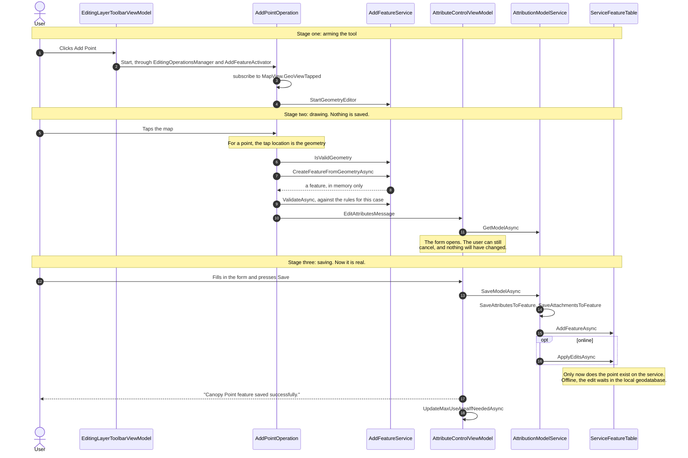
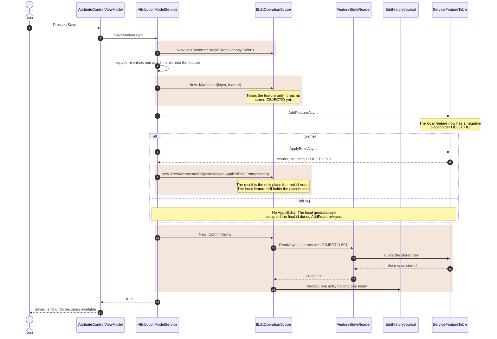
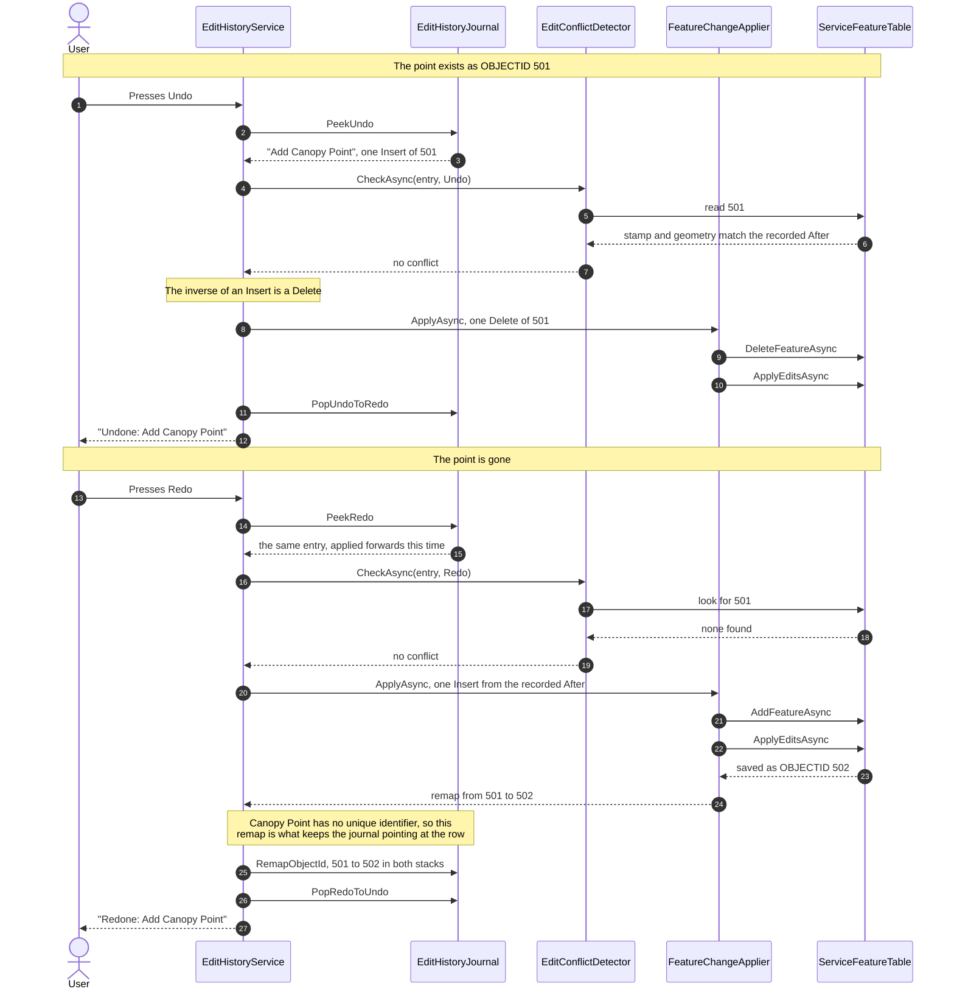

# Edit history: Create Point

How undo and redo work for creating a feature through the attribute form. Read the
[framework guide](../README.md) first; this document covers only what is specific to this feature.

## Summary

| | |
| --- | --- |
| User action | Draw a point, fill in the attribute form, Save. |
| Recorded as | One entry holding one `Insert`. |
| Undo | Deletes the row. |
| Redo | Re-inserts the row from the recorded snapshot, with a new `OBJECTID`. |
| Operation name | `Add {layer}`, for example `Add Canopy Point`. |
| Recording site | `AttributionModelService.SaveModelAsync` |

## Scope: more than points

The recording sits in the shared save path for the generic attribute form, not in a point specific
class. Every save through `AttributionModelService.SaveModelAsync` in one of these modes records an
insert, whatever the layer's geometry:

| `AttributionMode` | Operation name |
| --- | --- |
| `New` | `Add {layer}` |
| `Import` | `Import {layer}` |
| `ImportSketch` | `Import sketch to {layer}` |

`Modify` and `ModifySketch` open a scope but capture nothing, so nothing is recorded and the journal
is untouched.

LPIS parcel saves go through `LpisAttributionModelService` and its own form view model, which do not
record. Creating an LPIS parcel is not undoable.

Canopy Point is the layer this was built and tested against. Other layers that reach this path are
recorded by the same code but have not been checked end to end; see
[Known limitations](#known-limitations) before relying on them.

## Data affected

For Canopy Point, one row in one table.

`AttributeControlViewModel.Save` calls `MaxUseAreaService.UpdateMaxUseAreaFromFeatureAsync` after
the save. For Canopy Point that call does nothing: the service only acts on `Permanent_Deduction`
and `LPIS_Poly`, and returns early for every other layer.

Canopy Point has no unique identifier. `LPISPOLYID` names the parent parcel and is shared by every
point in it. The row's identity is its `OBJECTID` alone, so this feature depends entirely on object
id remapping.

## How a point is created

Drawing a point does **not** save anything. It opens the attribute form, and the feature is only
written when the user presses Save. Three stages, with a gap between each:



- **Arming.** `AddPointOperation.Start` subscribes to map taps and starts the geometry editor.
- **The tap is the geometry.** There is no multi-vertex sketch to finish.
- **`CreateFeatureFromGeometryAsync`** builds a feature object in memory. It is not in the table
  and not on the service.
- **The form opens.** `AttributeControlViewModel` receives the unsaved feature. Cancelling here
  leaves no trace.
- **`SaveModelAsync`** writes the feature. This is the first moment there is anything to undo,
  which is why recording attaches to the save and not to the drawing.

## Recording

The scope wraps `AttributionModelService.SaveModelAsync`. The highlighted blocks are the additions;
the rest of the method is unchanged.



If anything throws before `CommitAsync`, the method's catch reverts local edits and returns false,
and the `using` disposes the scope uncommitted. Nothing is recorded.

The code, with line numbers in
`Src/MiEditor.Core/Services/Drawing/Editing/Attributes/AttributionModelService.cs`:

```csharp
using var editScope = editRecorder.Begin(OperationNameFor(mode, targetLayer));      // line 77

try
{
    await SaveAttributesToFeature(feature, fields, additionalFields, mode);
    await SaveAttachmentsToFeature(feature, files);
    // resolve featureServiceTable

    switch (mode)
    {
        case AttributionMode.New:
        case AttributionMode.Import:
        case AttributionMode.ImportSketch:
            editScope.MarkInsert(targetLayer, feature);                             // line 98
            await featureServiceTable.AddFeatureAsync(feature);
            break;
        // Modify modes update without recording
    }

    if (!isOffline && featureServiceTable is ServiceFeatureTable serviceFeatureTable)
    {
        var applyEditsResult = await serviceFeatureTable.ApplyEditsAsync();
        // throws InvalidOperationException on any result with an error

        editScope.ResolveInsertedObjectIds(targetLayer, AppliedEdit.From(applyEditsResult));   // line 125
    }

    await editScope.CommitAsync();                                                  // line 130
    return true;
}
catch (Exception ex)
{
    // UndoLocalEditsAsync, log, return false
}
```

### Why each line is where it is

- **`Begin` wraps the whole method in `using`.** Any early return or exception disposes the scope
  uncommitted, so a failed save records nothing. The catch also calls `UndoLocalEditsAsync`, so a
  failed save leaves no local edit behind either.
- **`MarkInsert` only notes the feature.** The row has no stored object id yet. After
  `AddFeatureAsync` a service table gives the feature a negative placeholder id.
- **`ResolveInsertedObjectIds` is required online.** `ServiceFeatureTable.ApplyEditsAsync` does not
  write the assigned `OBJECTID` back onto the local feature. The only place the real id exists is
  the `EditResult`. Without this call, the history would record the placeholder, the next undo
  would query `OBJECTID IN (-107954041)`, find nothing and refuse the undo as "deleted by someone
  else".
- **Offline needs no resolve.** The local geodatabase assigns the final id during `AddFeatureAsync`,
  and the recorder reads it from the feature.
- **`CommitAsync` runs after `ApplyEditsAsync`.** It reads the stored row back by its real id, so
  the recorded after state includes service-assigned values such as `MODIFIEDDT`.

### What the entry contains

```
EditOperationEntry
  OperationName  "Add Canopy Point"
  CaseKey        the open case number
  Changes
    Insert
      After  FeatureSnapshot of the stored row: OBJECTID, geometry JSON,
             MODIFIEDDT stamp, every attribute
```

## Undo and redo

An insert has no before state, only an after. Undo is therefore a delete with nothing to restore,
and redo inserts the recorded row again. The guards, the case check and the tool stand-down that
run first are the same for every feature and are shown in the
[framework guide](../README.md#undo-and-redo).



### Undo

1. The conflict check reads the row by `OBJECTID` and compares it with `After`. It is refused if
   the row is gone, its `MODIFIEDDT` has changed, or its geometry has changed.
2. The inverse is `Delete(After)`. The applier finds the row by `OBJECTID` and deletes it, then
   calls `ApplyEditsAsync` when online.
3. The entry moves to the redo stack. Selection is cleared. The toast reads
   "Undone: Add Canopy Point".

### Redo

1. The conflict check expects no row (the `Before` of an insert is null). It is refused if a row
   with the recorded `OBJECTID` exists again.
2. The applier creates a new feature from `After`: geometry plus every writable attribute that
   exists on the table. `OBJECTID`, `GLOBALID` and `SHAPE*` are left to the service.
3. After `ApplyEditsAsync`, the new `OBJECTID` is matched from the result and returned as an
   `ObjectIdRemap`. The journal rewrites the old id to the new one in both stacks.
4. The entry moves back to the undo stack. The toast reads "Redone: Add Canopy Point".

Every redo produces a new `OBJECTID`, so repeated undo and redo is the remap path under test.

## Failure handling

| Situation | Result |
| --- | --- |
| Save fails, or the form is cancelled | Nothing recorded. |
| `ApplyEdits` reports an error | `SaveModelAsync` throws internally, reverts local edits, returns false. Nothing recorded. |
| Online result does not match the number of inserts | Insert not recorded, warning logged. The save itself succeeded. |
| Row cannot be read back at commit | Insert not recorded, warning logged. |
| Entry larger than `MaxTotalBytes` | Not recorded. The user is warned it cannot be undone. |
| History switched off | Discarding scope, nothing recorded, no extra queries. |

## Known limitations

- **A failure inside `CommitAsync` is reported as a failed save.** `CommitAsync` is the last
  statement inside the method's `try`. If the read-back throws (for example, the connection drops
  after `ApplyEditsAsync`), the catch returns false and the form shows "Save operation failed"
  although the feature was saved. Move Point avoids this by giving the commit its own catch; the
  same change has not been made here.
- **Attachments are not restored on redo.** `SaveAttachmentsToFeature` adds attachments, but a
  snapshot holds geometry and attributes only. A redone feature comes back without them.
- **`Permanent_Deduction` inserts are only partly reversible.** For that layer,
  `UpdateMaxUseAreaFromFeatureAsync` runs after the save, outside the scope, and writes `MAXUAREA`
  on the parent LPIS parcel. Undo removes the deduction but leaves the recalculated `MAXUAREA`.
- **Other layers have not been tested.** Lines, polygons, imports and sketch imports through this
  path record the same way, but have not been checked in the running application.

## Tests

| Test class | Relevant coverage |
| --- | --- |
| `Recording/EditOperationRecorderTests` | The insert path, for example `An_Insert_Online_Records_The_Id_The_Service_Assigned_And_Not_The_Placeholder`, `An_Insert_Online_With_ResolveInsertedObjectIds_Forgotten_Is_Refused_Rather_Than_Recorded_Wrong`, `An_Insert_Offline_Mode_Takes_The_Id_From_The_Feature`, `When_The_Counts_Disagree_Nothing_Is_Recorded_Rather_Than_Guessed`, `A_Scope_Never_Committed_Records_Nothing`. |
| `Model/AppliedEditTests` | The `MatchInsertedIds` pairing rule. |
| `Applying/EditHistoryServiceTests` | The undo and redo pipeline, remap forwarding, refusals. |
| `Applying/EditConflictDetectorTests` | The conflict rules. The "row should not exist" rule that redo of an insert relies on is tested through `A_Row_Somebody_Else_Recreated_Is_A_Conflict_When_Undoing_A_Delete`; there is no insert specific test. |

`AttributionModelService` itself has no unit tests for the recording lines.

## Manual checks

1. Select Canopy Point as the editable layer, turn History on in settings.
2. Draw a point, fill the form, Save. Undo becomes available.
3. Undo. The point disappears, "Undone: Add Canopy Point".
4. Redo. The point returns.
5. Repeat undo and redo several times. Each redo gives the point a new `OBJECTID`.
6. Draw a point and Cancel the form. Undo does not become available.
7. Save a point, then switch case. Undo is unavailable on return.
8. Double click Undo. Only one undo happens.
9. Save a point, edit the same point from another session, then Undo. It is refused with a warning
   and removed from the history.
