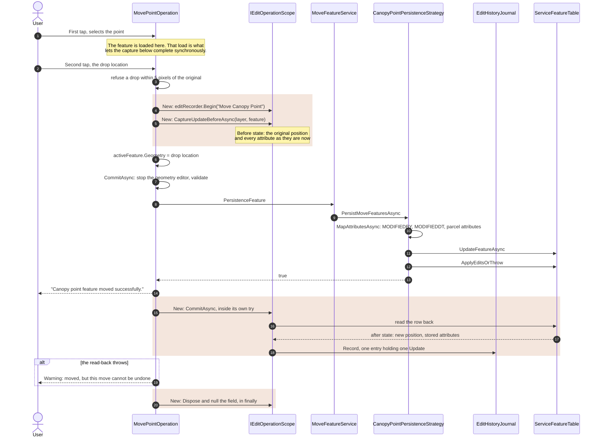
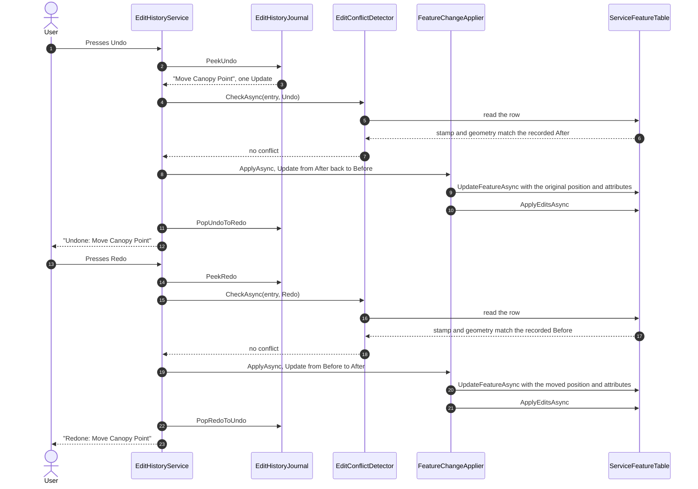

# Edit history: Move Point

How undo and redo work for moving a point. Read the [framework guide](../README.md) first; this
document covers only what is specific to this feature.

## Summary

| | |
| --- | --- |
| User action | Select a point with a first tap, drop it at a new location with a second tap. |
| Layers | Canopy Point only. |
| Recorded as | One entry holding one `Update`. |
| Undo | Restores the recorded before state: position and every writable attribute. |
| Redo | Re-applies the recorded after state. |
| Operation name | `Move {layer}`, for example `Move Canopy Point`. |
| Recording site | `MovePointOperation`, split across the tap handler and `CommitAsync`. |

## Data affected

One row in one table.

- `MoveFeaturePersistenceStrategyFactory` returns `CanopyPointPersistenceStrategy` for Canopy Point
  and throws `NotSupportedException` for every other layer, so no other layer can be moved.
- `CanopyPointPersistenceStrategy` calls `UpdateMaxUseAreaFromFeatureAsync`, which returns early for
  Canopy Point, so no `MAXUAREA` is written on a parent parcel.
- An update keeps the row's `OBJECTID`, so neither undo nor redo needs object id remapping.

This is the simplest shape the framework handles: one `Update`, one row, no remap.

## Recording

`Src/MiEditor.Core/Services/Drawing/Editing/MoveFeatures/Operations/MovePointOperation.cs`

### Why the capture is in the operation class

The persistence strategy receives the feature **after** its geometry has been reassigned:

```csharp
activeFeature.Geometry = e.Location;   // MovePointOperation, second tap

await CommitAsync();                   // validates, then persists through the strategy
```

A capture in `CanopyPointPersistenceStrategy` would snapshot the new position, and undo would put the
point back where it already is. The last moment the original position exists is just before that
assignment, so the capture goes there.

### The whole move, recorded

The highlighted blocks are the additions. The capture and the commit sit in different methods of
`MovePointOperation`, a tap apart.



Every early exit between the capture and the commit, such as a validation failure, a cancelled case
request or an exception, still reaches the `finally`, so the scope is disposed uncommitted and
nothing is recorded.

### The capture, in `MapView_GeoViewTapped` (second tap branch)

```csharp
editScope = editRecorder.Begin($"Move {layerName}");
await editScope.CaptureUpdateBeforeAsync(layerName!, activeFeature);

activeFeature.Geometry = e.Location;

await CommitAsync();
```

### The scope is a field

The capture and the commit are in different methods, so the scope is held in a field:

```csharp
private IEditOperationScope? editScope;
```

This is safe because `CommitAsync` has exactly one caller, which opens the scope two statements
earlier, and its `finally` disposes and nulls the scope on every exit:

```csharp
finally
{
    editScope?.Dispose();
    editScope = null;
    // existing cleanup
}
```

A validation failure, a cancelled case request or an exception therefore records nothing.

### The commit, in `CommitAsync`

```csharp
var result = await moveFeatureService.PersistenceFeature(mapView, activeFeature, this.layerName!);

if (result)
{
    notificationManager.Show(MovePoint, "Canopy point feature moved successfully.", NotificationType.Success);
    Clear();

    try
    {
        await editScope!.CommitAsync();
    }
    catch (Exception historyEx)
    {
        loggerService.Error(historyEx, "Move point feature was saved but could not be recorded in the edit history.");

        notificationManager.Show(
            MovePoint,
            "The canopy point was moved, but this move cannot be undone.",
            NotificationType.Warning);
    }
}
```

The commit is last, after the success notification, and has its own catch. `CommitAsync` reads the
row back through the feature service, so it can throw after the move has been saved. Without the
inner catch, that exception would reach the outer catch and the user would see "moved
successfully" followed by "could not be moved". The warning confirms the move and says exactly what
is missing, so the user does not reach for an undo that is not there.

The `!` on `editScope` is an assertion, not a gap: `CommitAsync` is not on `IMoveFeatureOperation`
and its only caller sets the field first.

### ApplyEdits errors now throw

`CanopyPointPersistenceStrategy` used to log every `ApplyEdits` result and return success
regardless. With history recording the move, a rejected move would leave an undo that puts the point
back somewhere it never left. It now throws on any result with errors, following
`DeleteFeatureService.ApplyEditsOrThrow`:

```csharp
var results = await serviceFeatureTable.ApplyEditsAsync();

var errors = results?.Where(r => r.CompletedWithErrors).ToList();
if (errors != null && errors.Count != 0)
{
    var error = errors[0].Error ?? new Exception($"ApplyEdits failed for table '{layerName}'.");
    loggerService.Error(error, $"ApplyEdits failed for a move on table '{layerName}'.");
    throw error;
}
```

The exception reaches the outer catch in `MovePointOperation.CommitAsync`, which now shows "The
canopy point could not be moved. Please try again." Before this change that catch only logged, so a
rejected move cleared the graphic and said nothing.

### What the entry contains

```
EditOperationEntry
  OperationName  "Move Canopy Point"
  CaseKey        the open case number
  Changes
    Update
      Before  snapshot taken at the capture: original geometry, original attributes
      After   snapshot read back from the table at commit: new geometry,
              attributes as stored, including the updated MODIFIEDDT
```

## Undo and redo

An update keeps its `OBJECTID`, so neither direction remaps anything. Undo writes the recorded
before state back; redo writes the recorded after state. The guards, the case check and the tool
stand-down that run first are shown in the [framework guide](../README.md#undo-and-redo).



### Undo

1. The conflict check reads the row by `OBJECTID` and compares it with `After`. It is refused if
   the row is gone, its `MODIFIEDDT` has changed, or its geometry has changed.
2. The inverse is `Update(After, Before)`. The applier finds the row and writes `Before`'s geometry
   and every writable attribute, then calls `ApplyEditsAsync` when online.
3. The entry moves to the redo stack. Selection is cleared. The toast reads
   "Undone: Move Canopy Point".

Undo restores attributes as well as position, because the snapshot holds every attribute. This
matters for a move: `CanopyPointPersistenceStrategy.MapAttributesAsync` sets `MODIFIEDBY` and
`MODIFIEDDT` and re-derives the parcel attributes from the new position through
`GetLpisParcelAttributes`. Undo puts all of those back to their recorded values. Note that this
includes `MODIFIEDDT`, so after an undo the row's stamp is the one from before the move, not the
time of the undo.

### Redo

1. The conflict check compares the row with `Before`, which is what the undo restored.
2. The applier writes `After`'s geometry and attributes.
3. The entry moves back to the undo stack. The toast reads "Redone: Move Canopy Point".

## Failure handling

| Situation | Result |
| --- | --- |
| Drop within 5 pixels of the selected location | Warning, no scope opened. |
| Validation fails, or the case request is cancelled | Scope disposed in `finally`. Nothing recorded. |
| `ApplyEdits` rejects the move | Error "could not be moved". Nothing recorded. |
| Move saved, history read-back throws | Warning "moved, but this move cannot be undone". Nothing recorded. |
| History switched off | Discarding scope. Nothing captured or recorded. |

## Reentrancy: a guarantee that lives in another method

`MapView_GeoViewTapped` is `async void`, and `activeFeature`, `featureSelected` and `editScope` are
fields read across awaits.

Before this change the second tap branch ran without awaiting until `CommitAsync`, whose
`StopGeometryEditor` call is synchronous and precedes every await, so a second tap could not enter
the branch. The capture adds an await in that region.

It is still single entry, but only because:

- `FeatureSnapshotFactory.CreateAsync` awaits nothing except `LoadAsync`, and skips that for a
  feature that is already loaded;
- the first tap has already loaded the feature.

So the capture completes synchronously and the UI thread does not pump.

**If either half changes, this breaks silently.** If the load on the first tap is removed, or a path
reaches the second tap without the first, a second tap could overwrite `editScope`, orphan the first
scope, and the first continuation would then hit `editScope!.CommitAsync()` after the field had been
nulled. Nothing tests this, because `MovePointOperation` depends on `MapView`. Both the capture site
and this document say so; keep them in sync.

Separately, and older than the history work: a second tap during a save can enter the select branch
and reassign `activeFeature`, which the in-flight `CommitAsync` then persists.

## Tests

`Recording/EditOperationRecorderTests` covers the update path the move depends on:

| Test | Guards |
| --- | --- |
| `The_Before_State_Is_Fixed_When_It_Is_Captured_Not_When_It_Is_Committed` | The before state is the original position, not the position at commit time. The most important test for this feature. |
| `An_Update_Records_The_Captured_Before_State_And_The_Stored_After_State` | The after state is read from the table, not reused from the capture. |
| `An_Update_Whose_Row_Cannot_Be_Read_Back_Is_Not_Recorded` | A failed read-back records nothing. |
| `An_Update_Reads_Back_The_Row_It_Captured` | The read-back targets the captured identity. |
| `With_The_History_Off_An_Update_Capture_Takes_No_Snapshot` | No cost when the switch is off. |

The first test needs the snapshot factory mock to answer from the feature as it stands when called,
not from a fixed value. That is the only way a test can tell when the before state was taken.

`MovePointOperation` and `CanopyPointPersistenceStrategy` have no unit tests. Both need a live
`MapView`. Their changes are kept free of logic for that reason and are verified in the running
application.

## Manual checks

1. Move a canopy point. Undo. It returns to where it started, with its attributes.
2. Redo. It moves back to the new position.
3. Undo, redo, undo. The entry survives the round trip.
4. Move a point, move it again, undo twice. Both moves are reversed in order.
5. With History off, move a point. Nothing is recorded and the Undo button stays hidden.
6. Force the service to reject a move. The user sees "could not be moved", not a success message
   and not silence. Nothing is recorded.
7. Let the move succeed, then drop the network before the read-back. The user sees the success
   message followed by "this move cannot be undone", never "could not be moved", and Undo does not
   offer the move.
